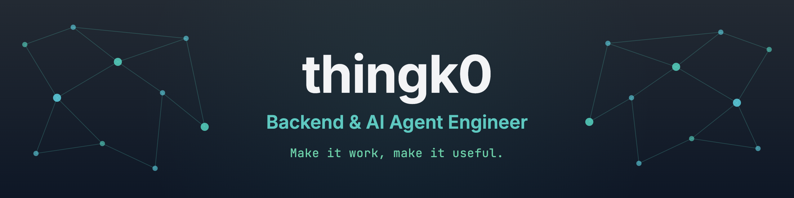

고명성 · <strong><a href="https://www.thingk0.website/portfolio/">Portfolio</a></strong> | <strong><a href="https://www.thingk0.website/blog/">Blog</a></strong>

 

## About

I work across backend and AI, building systems that are meant to run in real products.

I have built Java/Spring API servers, and I am currently working on Python/FastAPI-based AI agents and data query systems.

- Built core APIs for a Tableau extension product
- Implemented ACL, license sync, and log analysis APIs
- Developed a Text-to-VDS query agent and orchestration-based multi-agent workflows
- Designed metadata management flows and a Neo4j-based Hybrid RAG pipeline

 

## Skills

<strong>AI &amp; Search</strong>

 

<strong>Backend</strong>

<strong>Cloud &amp; DevOps</strong>

<strong>Other Languages</strong>

 

## Now

- Building a query agent on top of Tableau VizQL Data Service
- Designing semantic-layer and metadata management flows
- Running a personal RAG playground and writing about it on the blog

 

## Background

- **SSAFY 10th Cohort**
- **Myongji University, Information and Communication Engineering**

 

## Latest Posts

<!-- BLOG-POST-LIST:START -->
- [AI 코딩 에이전트 지침서 최적화 — AGENTS.md 단일화와 온디맨드 스킬 시스템 구축기](https://www.thingk0.website/blog/2026/10/01/ai-agent-modular-rules-context-optimization/)
- [일정 AI의 카테고리만 Jev에게 &lpar;1&rpar;: 생성형 LLM 대신 판별 모델 도입하기](https://www.thingk0.website/blog/2026/09/30/solar-to-jev-category-migration/)
- [블로그 빌드 속도 25% 단축기 — Mermaid 지연 로딩과 Astro 동시성](https://www.thingk0.website/blog/2026/09/25/astro-blog-build-optimization/)
<!-- BLOG-POST-LIST:END -->

